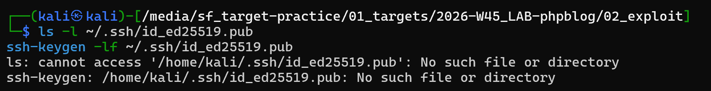
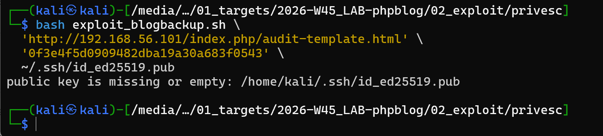
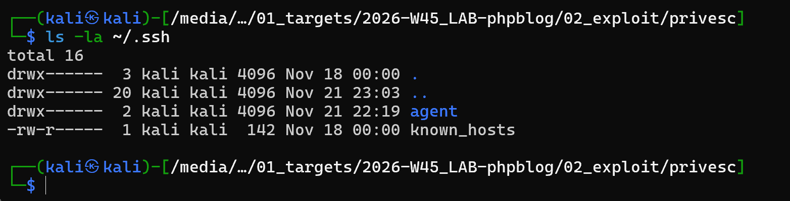
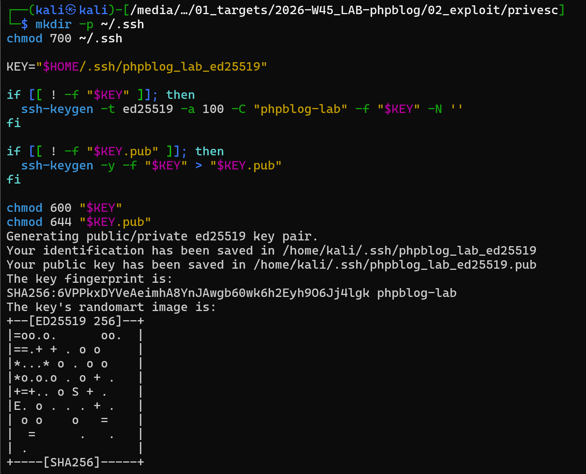

# LAB / phpblog 靶机技术复盘报告

> 文档性质：靶机技术报告与个人复盘，不是周报。
>
> 复盘范围：2026-W45 至 2026-11-22，包括前期自主探索、后续按指导复现、
> 最终 root 验证和环境收尾。

| 项 | 内容 |
|---|---|
| 靶机 | LAB / phpblog |
| 目标地址 | `192.168.56.101` |
| 系统 | Debian 13 |
| Web 环境 | Apache 2.4.68、PHP-FPM 8.4.24、Typecho 1.3.0 |
| 最终结果 | 取得 `momo` RCE 和 root 权限，读取 root flag |
| 完成方式 | 前期源码/离线数据审计 + 后续按 WP 复现，属于借助提示完成 |
| 最终 flag | `flag{root-7e934684eafe9fe6f1c32d6b06207c7f}` |

---

## 1. 总体结论

本次 phpblog 靶机的完整攻击链为：

```text
端口与服务识别
  → Typecho 主题入口和源码线索
  → 匿名上传 PHP
  → 页面模板路径穿越
  → momo 用户 RCE
  → root 备份服务 token 暴露
  → 可写 job/staging 驱动 root 文件恢复
  → 写入 root authorized_keys
  → root shell 与 flag
```

从任务目标看，靶机已经完成最终夺旗。当前环境已经清理：

- 恢复原始 `/root/.ssh/authorized_keys`；
- 删除实验 job 和 staging 文件；
- 删除临时 Web Shell；
- 验证实验私钥不能再登录 root；
- 验证 Web 页面不再返回低权限命令执行结果。

从能力成长看，本次最重要的收获并不是“拿到一个 flag”，而是认识到三个阶段需要不同问题模型：

| 阶段 | 核心问题 | 本次实际答案 |
|---|---|---|
| 侦察 | 哪些服务、版本和输出值得继续追 | 80 端口的 Typecho 和自定义主题比操作系统版本更可疑 |
| 立足 | 哪个输入能写文件、读文件或执行代码 | 公开上传可写文件，页面模板名可跳出主题目录并被 `require` |
| 提权 | 普通用户能驱动哪个高权限动作 | `momo` 可写 root 备份服务的任务和 staging 目录 |

---

## 2. 对端口扫描结果的分析思路

### 2.1 扫描结果不能被理解成“端口列表”

本次关键扫描结果：

```text
22/tcp open ssh  OpenSSH 10.0p2 Debian
80/tcp open http Apache httpd 2.4.68 (Debian)
    http-generator: Typecho 1.3.0
```

面对一行结果，至少需要同时看六个字段：

| 字段 | 需要提出的问题 | 本次意义 |
|---|---|---|
| 端口 | 它暴露的是哪一类能力 | 22 是远程管理，80 是 Web 应用 |
| 状态 | 是真开放、过滤还是关闭 | 22/80 均开放，可以继续验证 |
| 服务名 | 协议和应用是什么 | SSH、HTTP |
| 版本 | 有没有已知漏洞或配置弱点 | 版本本身不是结论 |
| 脚本输出 | 服务泄露了哪些应用级特征 | 发现 Typecho 1.3.0，比泛泛扫 Apache 更有价值 |
| 后续可达性 | 拿到权限后它是否还能利用 | SSH 是后期登录方式，80 是初始入口 |

我一开始更容易把注意力放在“版本旧不旧”。经过本次后，我认为更有效的判断顺序是：

```text
是否有业务入口
  → 入口是否需要认证
  → 是否接受文件、路径、模板、命令或数据库参数
  → 返回内容是否泄露源码、版本、路径或用户信息
  → 是否存在可组合的写入与执行条件
  → 最后才判断已知 CVE 是否匹配
```

### 2.2 什么样的扫描信息算“可疑”

本次资料中可以整理出四类高价值信号。

#### A. 应用指纹比通用服务版本更具体

`Apache 2.4.68` 只说明 Web 服务器类型。真正把攻击面缩小到本题的是：

```text
Typecho 1.3.0
X-Pingback: /index.php/action/xmlrpc
/usr/themes/classic-22/submit/
/usr/themes/classic-22/docs/changelog.md
```

这些信息告诉分析者：有自定义主题、有公开功能、有版本线索，应该进入应用代码和业务功能分析。

#### B. 公开写入口

“读者投稿”页面无需登录，并且接受附件。它同时满足两个高风险条件：

```text
外部用户可控输入 + 服务端文件写入
```

看到上传点时应继续确认：

1. 文件写到哪里；
2. 文件名、扩展名是否可控；
3. 目录是否可执行；
4. Web 用户是否能读取；
5. 是否还有其他功能会再次读取该文件。

#### C. 路径型参数

页面模板的 `template` 参数最终进入：

```php
require_once $this->themeDir . $this->themeFile;
```

这类“参数最终拼接到文件系统路径”的位置比单纯版本号更值得优先分析。

#### D. 内网或回环服务

外部扫描看不到 `127.0.0.1:9001`，但拿到低权限后可以通过进程发现：

```text
root ... /opt/blogbackup/agent.py --token <TOKEN> --listen 127.0.0.1:9001
```

因此完整侦察不能只看第一次 nmap。权限变化后需要重新枚举：

```bash
ps -eo user,pid,args
ss -lntp
find / -perm -4000 -type f 2>/dev/null
find / -perm -2000 -type f 2>/dev/null
```

### 2.3 本次形成的扫描分析清单

以后看到扫描结果，我会依次问：

1. 哪些端口对应“人可交互”的业务，而不是纯基础设施？
2. 返回头、首页 HTML、错误页和已知路径泄露了什么框架与版本？
3. 是否存在上传、导入、导出、模板、备份、恢复、命令和搜索参数？
4. 输入最终流向文件、进程、数据库还是网络请求？
5. 当前用户能否写入中间目录？
6. 服务是否以更高权限运行？
7. 当前结论是“事实”还是“猜想”，下一步用什么最小实验验证？

这个清单可以迁移到固件研究：固件解包后，Web 端口、CGI、配置导入和升级恢复页面就是扫描结果在代码层面的对应物。

---

## 3. 获取低权限入口：为什么不能先盲目爆破

### 3.1 我在过程中的认识变化

一开始为了尽快获得 shell，曾把“常见用户名 + 常见密码”的重复尝试当成主要路径。后来我意识到：

```text
没有任何用户名、口令策略或认证行为证据时，
连续尝试默认口令和短口令并不是分析，而是盲猜。
```

这类操作有三个问题：

- 时间不可控，容易把大量精力耗在低信息量动作上；
- 会产生大量认证日志，可能触发封禁；
- 即使偶尔成功，也不能解释系统为什么存在漏洞。

我的判断是：**弱口令测试可以作为清单中的一个小步骤，但不能替代对业务数据流的分析。**

### 3.2 更适合入门阶段的低权限入口顺序

| 顺序 | 方向 | 需要看的证据 |
|---|---|---|
| 1 | 公开业务功能 | 上传、导入、模板、搜索、评论、预览、备份 |
| 2 | 源码与备份泄露 | `.git`、`.bak`、压缩包、更新日志、调试页 |
| 3 | 文件路径控制 | `include`、`require`、`file_get_contents`、模板名 |
| 4 | 任意文件上传 | 文件落点、扩展名、目录权限、是否被其他代码加载 |
| 5 | 认证与会话 | Cookie、会话文件、重置流程、权限校验 |
| 6 | 已知漏洞 | 只有版本、入口和前置条件都匹配时才测试 |
| 7 | 凭据复用 | 配置文件、数据库、日志、历史文件中有明确用户名后再测 |

本题真正有效的入口不是爆破，而是组合：

```text
公开投稿上传
  + 页面模板路径穿越
  + /tmp 在 PHP open_basedir 中
  = momo RCE
```

这说明低权限立足点需要找“成对的条件”，而不是单独追求某个漏洞名。

### 3.3 从低权限到 root 的常规思路

本次之后，我会先建立权限图，而不是立即运行大量自动化提权脚本。常用方向包括：

1. **`sudo`**：先执行 `sudo -l`，确认允许的命令和参数。
2. **SUID/SGID**：检查以 root 运行且允许文件读写、命令执行或解释器逃逸的程序。
3. **cron 与 systemd**：找 root 周期执行、但普通用户可写的脚本、参数或目录。
4. **文件权限**：检查服务配置、密钥、数据库、备份和日志是否可写。
5. **Capabilities**：检查 `cap_setuid`、`cap_dac_read_search` 等能力。
6. **环境与路径**：检查 root 脚本中的 `PATH`、相对路径和外部程序调用。
7. **高权限服务**：检查 root 服务是否读取普通用户可写文件，或接受本地 API 请求。
8. **组权限**：确认 Web 用户所在组是否拥有目录写权限。
9. **内核漏洞**：放在最后，因为稳定性风险高，且应先用最小配置问题排除。

本题的关键是第 7 项：`blogbackup.service` 使用 root 身份，`jobs/` 和 `staging/`
又允许 `momo` 组写入。普通用户不需要直接写 root 文件，只需让 root 服务替自己复制文件。

后续遇到类似机器，我会先运行：

```bash
id
sudo -l
ps -eo user,pid,args
find / -perm -4000 -type f 2>/dev/null
find / -perm -2000 -type f 2>/dev/null
systemctl list-units --type=service --state=running --no-pager
find /etc/systemd/system /etc/cron* -maxdepth 2 -type f -ls 2>/dev/null
getcap -r / 2>/dev/null
```

它们的顺序体现的是“先看设计明确的权限，再看模糊和复杂的入口”。

---

## 4. 公钥、私钥与恢复服务的风险反思

### 4.1 我的原始疑问

复现到 root 提权阶段时，我遇到了找不到公钥的问题，并进一步提出：

> 创建公钥私钥本身是不是有风险？理论上应该有低风险或无风险的常规操作吧？

这个疑问很重要。经过核对，需要把一个动作拆成三个不同阶段：

```text
1. 本地生成密钥对：低风险
2. 在靶机上登记公钥：可能改变认证配置
3. root 恢复服务覆盖 authorized_keys：高风险
```

真正有破坏性的不是第 1 步，而是第 3 步。

### 4.2 截图与问题定位

#### 表面现象：找不到公钥



`~/.ssh/id_ed25519.pub` 不存在，因此 `ls` 和 `ssh-keygen -lf` 都失败。此处的 `~`
展开为 `/home/kali`，说明问题发生在 Kali 本地，不是靶机。

#### 脚本中止：安全检查生效



脚本在写 job 和调用 `/restore` 之前就检查公钥是否非空，因此这次失败没有进一步修改目标。

#### 目录核查：没有密钥对



目录中只有 `agent` 和 `known_hosts`：

- `known_hosts` 保存服务器指纹；
- `agent` 是 SSH agent 运行目录；
- 两者都不是可用于认证的私钥和公钥。

#### 修复：生成专用密钥对



使用 `/home/kali/.ssh/phpblog_lab_ed25519` 作为专用路径，不覆盖默认密钥；私钥权限为 `600`，
公钥权限为 `644`，并生成了可校验的 SHA-256 指纹。

### 4.3 创建密钥本身为什么风险低

`ssh-keygen` 只在本机生成两个本地文件：

```text
phpblog_lab_ed25519       私钥，必须保密
phpblog_lab_ed25519.pub   公钥，可以公开
```

它不会自动登录服务器，也不会自动修改 `authorized_keys`。使用独立文件名和“文件不存在才生成”
的判断后，也不会覆盖个人已有的默认 SSH 密钥。

仍需注意两点：

1. 私钥不能提交 Git、上传靶机或发送给他人。
2. 实验为了自动化使用了 `-N ''`，即无口令。长期使用的个人密钥应设置口令，并用
   `ssh-agent` 减少重复输入。

### 4.4 真正的高风险：`authorized_keys` 被截断覆盖

`blogbackup` 的恢复逻辑用 `O_TRUNC` 打开目标文件，意味着先清空再写入。如果 staging
中只有一个新公钥，恢复后的 root `authorized_keys` 也只剩这一个公钥。

本次第一次复现后观察到：

```text
原文件：1125 字节，2 个公钥
覆盖后：93 字节，1 个公钥
```

这不是密钥生成失败，而是“登记公钥”时没有保留原文件内容。

以后进行同类操作应遵循：

1. 先在虚拟机层打快照；
2. 能读取原文件时，先记录哈希和行数；
3. 生成“原始内容 + 新公钥”的完整合并文件；
4. 恢复后比较旧公钥和新公钥是否都仍然存在；
5. 实验结束后恢复原文件并验证实验私钥失效。

如果无法安全合并，就使用快照回滚，不直接覆盖 root 认证文件。

---

## 5. 本次探索中我的提问与对应理解

| 阶段 | 我的问题或判断 | 当时暴露的认知空白 | 现在形成的理解 |
|---|---|---|---|
| 起步 | 前置知识少，纯手动探索成本太高 | 缺少完整流程和概念地图 | 可以先借助高质量指导完成一次闭环，但每一步必须补上“为什么” |
| 复现 | 完全看不懂每一步操作的意义 | 把命令看成孤立字符串 | 命令要放回网络、Web、文件权限和进程身份四个模型中理解 |
| root 前 | 公钥文件为什么不存在 | 把 `known_hosts`、`agent` 误解为密钥 | `ssh-keygen` 生成的是独立密钥对；目录存在不代表密钥存在 |
| 公钥步骤 | 生成公私钥是不是有风险 | 混淆了本地生成与远程登记 | 本地生成风险低；远程登记、覆盖配置才是高风险动作 |
| 收尾 | 是否已经最终夺旗 | 缺少独立验证意识 | 必须同时验证 root 身份、flag、权限、日志，并清理持久化入口 |

这些提问说明，从“照着命令做”到“知道为什么做”需要主动停下来核对对象、位置和边界。

---

## 6. 个人能力评估

### 已经形成的优点

- 能在发现盲目尝试价值不高时主动暂停，而不是机械消耗时间；
- 能追问“这一步为什么存在”，并区分本地操作和目标操作；
- 能关注风险：不只问“能不能打通”，还问“会不会破坏原配置”；
- 能完成从低权限 RCE 到 root、再到清理验证的完整闭环。

### 仍需加强的地方

1. 端口和脚本输出还容易停留在“看到字段”，需要进一步形成威胁假设。
2. 对 Web 源码的数据流分析不熟，需要练习从参数追踪到 sink。
3. 提权清单尚未形成稳定的个人顺序，容易受工具输出影响。
4. 操作前备份和风险预判还不够自动化，曾发生覆盖原 `authorized_keys` 的问题。
5. 当前完成属于借助源码审计和指导的复现，尚不能算完全独立从零打通。

### 下一轮训练目标

- 在下一台靶机上独立完成“端口 → 应用指纹 → 入口假设”的前三十分钟；
- 先画数据流和权限图，再决定是否运行爆破工具；
- 对任何会写配置文件的步骤，先做快照、备份和目标内容核对；
- 打完后不看 WP，能用自己的话复述入口、根因、提权点和清理方法。

---

## 7. 与计算机专业和 IoT 方向的联系

这次复盘可以沉淀成三个可迁移能力：

| 本题能力 | 计算机专业基础 | IoT / 固件研究映射 |
|---|---|---|
| 端口和返回指纹分析 | 计算机网络、系统服务 | 固件 Web 管理面、CGI 与端口暴露 |
| 从输入追踪到执行 sink | 程序分析、编译原理、Web 安全 | 模板参数、配置导入、升级包解析 |
| 高权限文件与密钥操作 | 操作系统、访问控制、密码学 | 备份恢复、nvram、SSH、启动脚本和厂商维护接口 |

如果继续做科研训练，可以把本次问题抽象成两个研究问题：

1. 能否从 Web 请求参数自动追踪到动态模板包含，并判定其是否可达？
2. 能否基于用户、组、进程和文件权限图，自动识别“低权限目录 → root 恢复目标”的越权链？

这两个问题都可以用 Semgrep、CodeQL、固件解包脚本和人工验证样本形成小规模实验集。

---

## 8. 证据索引

- [端口服务扫描](01_recon/nmap_svc.txt)
- [低权限 RCE](05_evidence/lowpriv_rce.txt)
- [root 与 flag](05_evidence/02_root_proof.txt)
- [本轮复现的 root 证明](05_evidence/05_reproduction_root_proof.txt)
- [本轮复现的清理记录](05_evidence/06_reproduction_cleanup.txt)
- [清理后验证](05_evidence/07_post_cleanup_verification.txt)
- [找不到公钥](05_evidence/08_private_key_missing.png)
- [脚本中止](05_evidence/09_exploit_script_key_guard.png)
- [检查 .ssh 目录](05_evidence/10_ssh_directory_inspection.png)
- [生成专用密钥](05_evidence/11_keypair_generation.png)

报告结论：**phpblog 靶机已完成夺旗并完成环境收尾；本次最大的能力收获是建立“扫描结果分析 → 非盲目立足点选择 → 权限图提权 → 密钥操作风险管理”的个人方法论。**
